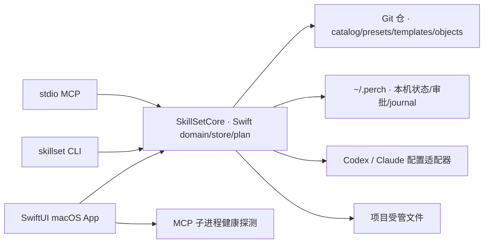

# 原生架构与数据契约

状态：Alpha 原生工作流切片（2026-10-22）。项目锁、离线对象、双宿主写入、来源预览与本机技能库导入、MCP 配置、Plugin 盘点与审批门控生命周期、CLI 与 stdio MCP 已实现；跨进程锁、marketplace 浏览和来源自动更新仍是目标设计。

## 1. 运行形态

产品是 macOS `.app`，由 SwiftPM 构建、由 `script/build_and_run.sh` 生成 bundle 后通过 `/usr/bin/open -n` 启动。没有浏览器页面、WebView、localhost API 或常驻同步守护进程。

CLI 随 App 放在 `Contents/Helpers/skillset`，与其 SwiftPM Core 资源一起打包；开发输出 `dist/skillset` 也携带同级资源。AI 接入页只检测程序和宿主配置，以用户级 MCP 计划连接宿主；不把资源存在、配置存在或 UI 已打开当作宿主已加载的证据。



SwiftUI 负责导航、预览、差异和人工审批；Swift core 负责来源、版本、manifest、路径安全、计划摘要和事务。正式版禁止 UI 自己读写受管文件，禁止 MCP 旁路 UI 授权。

## 2. SwiftPM 模块边界

```text
Package.swift
Sources/SkillSetCore/
  Models.swift                 Codable 领域对象、快照资源、MCP 草稿校验
  Deployment.swift             计划与 Skill 载荷指纹
  FileTransaction.swift        staging、hash 门、journal、恢复与回滚
  PlanStore.swift              计划、有效期和人工审批
  ProjectInspection.swift      项目观察、漂移和受管块
  ProjectOwnership.swift       本机归属收据、锁修订与计划读取依赖
  ProjectLock.swift            项目 manifest、锁文件与目标宿主
  SkillObjectStore.swift       内容寻址对象、核验与恢复
  MCPConfiguration.swift       Codex TOML / Claude JSON 扫描与受管块
  PluginInventory.swift        插件缓存、安装索引、组件与风险盘点
  PluginLifecycle.swift        固定宿主命令、状态复核与 Plugin operation
  SourcePreview.swift          GitHub 隔离 clone 与候选扫描
  SkillSetService.swift        App/CLI/MCP 共用服务边界
  Resources/                   catalog/sources/presets/templates/matt 快照
Sources/SkillSetApp/
  SkillSetApp.swift             WindowGroup、Commands
  Views/                        NavigationSplitView、页面和审批 sheet
  Stores/AppModel.swift         原生 UI 状态与共享服务调用
  Models/NavigationItem.swift   UI 导航和值对象
  Support/DesignSystem.swift    原生表面、状态徽章和小型布局组件
Sources/SkillSetCLI/
  CLIApplication.swift          CLI 命令与稳定退出码
  MCPStdioServer.swift          legacy stdio MCP 与工具 schema
Tests/SkillSetCoreTests/        Swift Testing 行为测试
```

应用的模板与预设可读取仓库 JSON/Markdown，SwiftPM resources 作回退；技能库只读取用户配置来源与本机索引，不自动加载仓库 catalog。项目草稿、计划、staging、operation 和来源缓存写入 ~/.perch。所有部署写入经过 `SkillSetService`，UI、CLI 和 MCP 不各自实现安装逻辑。

技能库编辑通过 `SkillLibraryStore` 保存到 `~/.perch/skills/`：`index.json` 记录 `personal/<slug>` 条目与外部隐藏条目，`packages/<uuid>/` 保存完整版本。每次编辑先复制旧包、替换 `SKILL.md`、计算部署同算法指纹，再原子切换索引；失败不修改旧索引或旧版本。删除只移除索引引用，历史包保留，外部条目可恢复隐藏。当前不提供跨进程编辑锁、历史版本恢复 UI 或缓存清理。

`SkillSetService` 初始化时合并仓库 catalog 和本机索引；部署计划从索引解析本地包路径，仍由原计划审批、对象存储和文件事务落地。编辑不写 `registry/catalog.json`、`vendor/`、全局技能或项目配置。`SKILL.md` 编辑只提取 name、description 和 version 供展示，保留原文与未知字段，不宣称完成完整 YAML schema 校验。

原生技能来源页通过列表标题的「＋」打开表单。编辑隔离预览时重新下载并固定版本，新记录保存成功后才移除旧记录；失败清理新隔离区并保留旧记录。删除按来源 UUID 移除 ~/.perch 内的对应缓存与搜索条目，不使用记录中的 `workspacePath` 作为删除目标，不改仓库 catalog。`requestedRef` 可选字段保存用户填写的分支、标签或提交，兼容不含该字段的旧记录。

来源导入经 `SkillSetService.sourceSkillImportDraft` / `importSourceSkill` 进入本机技能库。目录只从预览 UUID 和已扫描的相对路径推导，不信任 `workspacePath`；拒绝越界、目录软链替换及有完整性问题的候选。审阅和提交分别核对预览指纹与仓库根许可文件摘要，复制后再次验证原始包指纹。包中的 Git 数据不导入；仓库根 LICENSE / LICENCE / COPYING / NOTICE 文件保存在独立的 `_source_licenses` 目录（重名时追加下划线）。索引原子发布前失败会清理新包，既有同标识技能不可覆盖。

导入条目使用 `personal/<slug>`，可在导入表单修改标识；`LibrarySkillRecord.sourceOrigin` 保存仓库、固定 commit、原始相对路径、原始包指纹、许可线索和许可摘要。该可选字段兼容旧索引，本机编辑保留原始来源证据。部署指纹按最终包重新计算，包括保存的许可文件。预览删除或替换后，独立技能包仍可阅读、编辑并通过原部署计划部署；不自动更新已导入技能，不将导入等同于许可审核或项目启用。

## 3. 共享仓与本机状态

项目状态按 canonical realpath 的 SHA-256 保存在 `~/.perch/project-state/`。旧项目记录仅在有本机已完成 operation 收据且清单与锁一致时只读导入，下次部署写入本机状态；旧项目文件不再更新，也不自动删除。同名但无归属证据的用户文件不作为安装记录。旧待执行计划须重新生成。

全局技能与规则使用独立的 `GlobalConfigurationManager`，不复用项目登记或项目锁。宿主草稿、逐路径管理状态、首次接管基线与历史备份保存在本机状态目录，部署及三种还原操作复用 `SkillSetService` 与文件事务。共同祖先事务根不等于写入授权，执行前按所选宿主的技能路径、规则文件和本机状态文件精确校验。详细数据与恢复边界见 [全局配置、原始数据与还原](global-configuration.md)。

| 数据 | 权威位置 | 是否进入 Git |
| --- | --- | --- |
| Skill/Plugin/MCP 来源和不可变 revision | `registry/`、`vendor/`、对象 store | 是 |
| 预设和规则片段 | `presets/`、`templates/agents/` | 是 |
| 项目期望/锁 | `~/.perch/project-state/<canonical-path-sha256>/` | 否 |
| 项目 canonical realpath、旧 hash、备份、审批 | `~/.perch/` | 否 |
| 凭据 | macOS Keychain；仓库只存引用名和状态 | 否 |
| 外部 plugin/MCP 进程日志 | 本机操作目录，脱敏 | 否 |

`registry/local-import.json` 是本仓私有迁移凭证，包含原始绝对路径和 dirty 事实；公开导出必须剥离机器信息、凭据线索和未核准版权内容。

## 4. 领域对象

### Source / SkillRevision

`Source` 使用 `sourceId` 表示身份，字段包括 kind、canonical URL、requested ref、resolved commit、子路径、licenseReview 和 trust。`SkillRevision` 记录 skill ID、完整 commit 或 local snapshot、contentHash、逐文件 manifest、声明版本、许可和完整性。裸 skill name 不能作为唯一键。

内容 hash 算法为 `sha256:path-content-executable:v1`：解引用批准边界内的链接，按相对路径、文件 bytes 和 executable 位排序后对 canonical JSON 求 SHA-256；不包含 mtime、绝对路径或被明确排除的缓存。断链、循环、越界、特殊文件、大小/深度限制和秘密模式进入 blocked 报告。

### MCPServerRevision

字段：`host`、`serverName`、`scope`、`transport`、`command/URL`、`args`、`envKeyReferences`、`configNodeOwner`、`resolvedRevision`、`health`。Codex TOML、Claude `.mcp.json` 和 `~/.claude.json` 是不同格式，适配器必须分开 round-trip，保留未知字段和其他服务器。

MCP env 只记录变量名称或 Keychain 引用，绝不读取值。Codex 使用带标记的 TOML 受管块，Claude 使用 JSON 结构保留未知键；同名外部 server 会冲突阻塞，不会静默覆盖。管理器记录自己写入的 ownership，计划经过同一审批与文件事务。HTTP/OAuth 仍只生成配置；首发本应用的 AI 接入为 stdio，不监听端口。

### MCP 配置库与使用选择

`MCPLibraryEntry` 使用 UUID 标识，保存服务名称、transport、command/URL、args 和 envKeys，不绑定宿主或范围。本机 `~/.perch/mcp/library.json` 为权威配置库，新增、编辑、删除与扫描入库不写宿主。扫描只提取可复用连接字段，未知字段及凭据值不进入库；敏感连接或不支持的 TOML 参数不提供入库。批量入库先检查全部重名和有效性，再原子发布；提交前重新扫描候选，拒绝已经变化的连接。

全局和各登记项目按宿主独立保存 `mcp/drafts/<scope-host>.json` 中的选择 ID。已部署内容按真实配置路径的 SHA-256 保存在 `mcp/selections/<hash>.json`，包含条目快照和逐节点指纹。编辑配置库不会改变既有安装；删除库条目保留引用，取消引用后仍能通过已部署快照规划移除。此选择独立于预设中原有的结构化 MCP 草稿，旧预设工作流继续逐项生成计划。

`makeMCPLibraryPlan` 将单一宿主与范围的整组选择转换为 `mcp-configuration` 计划，一起暂存宿主配置和选择记录，审批、旧 hash、journal、回读与回滚复用现有文件事务。执行前按已登记项目或全局目标重建精确两文件白名单并核对 digest；事务共同根不授予其他路径写入权限。只更新配置库已有节点；外部同名服务阻塞，先前节点被外部修改或移除也阻塞。Codex 用户 TOML 与 Claude 用户/项目 JSON 分别转换，其他服务和顶层字段保留。全局配置影响该工具全部项目，项目选择不关闭全局继承。配置回读不证明宿主加载，跨进程锁仍未实现。

### PluginRevision

内部键为 `(host, marketplaceID, pluginName, sourceRevision)`。记录 manifest digest、宿主 version、严格的不可变 revision、来源、依赖图、组件清单、hooks/commands/MCP 风险和 license。Claude plugin manifest 可组合 skills、hooks、MCP、commands、agents；Codex plugin schema 证据不足，不能复制 Claude 字段。

插件版本与内容 revision 分开：宿主 `version` 仅兼容提示，内部锁必须有完整 commit/archive digest。依赖范围要检测 cycle、无解、同名遮蔽和 marketplace 更新漂移；命令来源、hooks、二进制 bundle 默认阻塞。

Plugin inventory 扫描项目 `.claude-plugin` / `.codex-plugin`、`~/.claude/plugins/cache` 和 `~/.codex/plugins/cache`，并叠加 Claude `installed_plugins.json` 与 Codex `config.toml` 的安装/启用事实。只读取 manifest 和组件目录，不跟随软链、不执行 hooks/commands、不调用安装器。缓存存在不等于已安装；revision 从宿主安装索引取得，manifest digest 单独计算。

Plugin lifecycle 复用 `DeploymentPlan` / `DeploymentPlanStore`，但执行器不是文件事务。计划在 staging 中保存 `PluginLifecycleCommand`，绑定 host、plugin id、scope、目标 manifest digest、working directory、CLI realpath、固定 argv 和 before observation digest。同一 id 存在多个缓存版本时，调用方必须选定具体 digest；apply 时重新扫描并为该摘要选择记录，任何漂移都返回 `PLUGIN_STATE_STALE`。命令通过 `Process` 直接启动，不经过 shell，不自动使用 `-y`。执行后按动作回读目标状态，并在 `operations/<uuid>/plugin-operation.json` 记录脱敏输出、退出码和结果。外部副作用无法用文件 rollback 撤销，必须生成相反动作计划。

### ProjectBinding / PresetRevision

ProjectBinding 以本机 canonical realpath + UUID 注册，包含目标 agent、scope、desired、managed observed 和 inherited observed。两个 Git worktree 可分别注册。PresetRevision 的仓库资源文件保持只读，本机 `presets.json` 保存 UI 新建和编辑的组合，初始组合通过同标识本机覆盖编辑；兼容旧版仅含技能与规则的 JSON。插件保存宿主、scope、标识、manifest digest 与可选 source revision，不保存缓存路径；载入与计划时重新解析本机清单并核对摘要。MCP 保存结构化连接草稿（含参数、环境变量名称），不从宿主观察中复制已收起的参数。规则使用现有 fragment，写入 AGENTS.md / CLAUDE.md 受管块。

应用预设只更新项目本机草稿；草稿同时保存 `plugins`、`mcpServers`，旧文档缺字段时读取为空，普通技能/宿主保存保留这两类内容。相同标识下的配置或插件摘要变化在 UI 标为更新。用户随后从项目页分别生成技能与规则部署、MCP 配置、插件生命周期计划；各计划沿用原有审批和执行器，不提供批量批准，不把从草稿移除解释为卸载。用户作用域会影响同宿主全部项目，UI 必须就近说明。

### AGENTS 片段库

本机 `templates.json` 保存用户片段、内置片段的同标识覆盖和删除记录，不改写仓库及 bundled resources。App 与 CLI/MCP 的 snapshot 合并同一片段库；用户输入的名称、说明和正文保留原文，内置名称与说明由界面翻译。保存校验名称、正文大小、重复名称及保留标记；文件损坏时拒绝覆写。删除不改项目和引用，失效引用在编辑界面提供移除入口，部署计划必须拒绝未知片段。既有计划内容与 digest 不因片段库变化而改变。

### Plan / Operation

Plan 是不可变的 `planId + digest`，绑定目标 realpath、动作、owner、expected old hash / observation、new hash、diff、风险、adapterVersion 和 10 分钟有效期。Operation 记录文件 journal/backup，或 Plugin 的宿主命令、前后观察、退出码和脱敏输出；两者由 `operations_get` 统一读取。

## 5. 项目安装状态机

```text
draft → planned → awaiting-approval → approved → applying → applied
                   ↘ expired       ↘ conflict / failed
failed → recovering → recovered / manual-intervention
applied → rollback-planned → approved → rolled-back / conflict
```

执行顺序：

1. 按 canonical project root 获取跨 UI/CLI/MCP 共用的锁（目标；当前尚未实现跨进程锁）。
2. 复核 plan digest、approval、目标 allowlist、父目录 realpath 和所有 expected old hash（已实现同进程服务校验）。
3. 在同一文件系统准备 staging，校验 new hash，持久化 journal 和 backup（已实现）。
4. 对受管路径逐一原子 rename，记录完成步骤；安装选择与版本记录由同一事务写入应用数据目录，用户项目只写宿主文件（已实现）。
5. 回读实际内容和权限，更新 operation（已实现）。

多文件、多目录不宣称原子。中断后的下一次启动先处理 journal；rollback 只恢复仍等于管理器上次写入值的文件，发现用户新编辑立即停止。

取消技能或宿主通过 `remove` 计划执行：校验旧指纹、备份、记录临时移走路径、rename 后确认目标不存在，再逐步写 journal。移除步骤的 `afterHash` 为空；rollback 从备份恢复，不需要伪造空目录 staging。恢复前预检已应用步骤的当前值、备份和恢复临时路径；恢复过程中逐步持久化 `rolling-back` / `restoring` / `rolled-back`，重启后可续办。预检不消除跨进程竞争，完整故障注入仍待补齐。

Plugin 状态机：

```text
observed → planned → approved → applying
                                  ├─ applied
                                  ├─ applied-verification-pending
                                  ├─ failed
                                  ├─ failed-before-launch
                                  └─ uncertain-interrupted
```

`uncertain-interrupted` 不自动重试。命令非零退出且未观察到目标状态时计划保持未消费，用户排查后可重新生成；不能把宿主命令视为可回滚文件事务。

## 6. 规则与宿主适配

默认受管块：

```markdown
<!-- skillset:begin id=project-rules schema=1 -->
确定展开内容
<!-- skillset:end id=project-rules -->
```

无标记时 plan 提议追加；一对完整标记只替换块；重复、交叉、缺尾或软链目标阻塞。块外 bytes 保留。当前实现可同时部署 Codex `.agents/skills` / `AGENTS.md` 与 Claude `.claude/skills` / `CLAUDE.md`，项目锁记录两个目标。祖先规则、`AGENTS.override.md`、Claude 加载链和会话重载仍是适配器设计。

默认部署为软链接，也可选择实体 copy；link 只能指向 ~/.perch/versions/<contentHash> 的固定版本包。链接指纹同时绑定目标绝对路径与内容指纹，生成计划、执行和回滚均复核；父目录和任意外部软链接继续拒绝。外部来源、项目目标和宿主配置不允许通过任意 symlink 越界。

归属依据是本机已完成 operation 的 `ownershipReceipt`，包含对应锁指纹、逐路径技能指纹和逐规则块正文指纹。锁的可选 `managementRevision` 给每次实际部署分配独立身份，避免同内容的不同部署历史误配收据；无变更时沿用原身份。项目锁和相同内容均不能单独证明归属，旧锁无本机收据时不自动接管或删除。项目计划记录 manifest、锁、所选/待移除路径与规则文件的读取依赖，执行前一起复核；旧版缺失收据与读取依赖的部署计划必须重新生成。

规则只校验受管块正文是否漂移，因此块外新增内容可以在新计划中保留；同标记且无归属的规则块不会被移除，正文不同则阻塞替换。取消宿主或更换受管块 ID 也要规划旧块清理。完整接入与退出管理边界见 [项目接入设计](project-integration.md)。

## 7. 安全边界

- 来源只在隔离目录读取；不 checkout/执行 hooks、filters、LFS、子模块、postinstall 或 skill scripts。
- URL 拒绝 credentials、未知 scheme、路径穿越、SSRF/DNS rebinding；分支含 `/` 时通过 refs 消歧。
- 宿主目标路径必须在用户注册项目根；管理记录仅允许写本机对应项目状态目录下两个固定文件；不通过 chmod、管理员权限或关闭保护绕过。
- AI、MCP caller、插件 manifest 不能添加新的写入根，不能把 `confirmed=true` 当批准。
- 日志脱敏：不记录 token、认证 URL、源码秘密、完整 approval handle 或全量 `.env`。
- 删除只触碰管理器拥有且未漂移的路径；未知插件/MCP 不静默停用或卸载。
- Plugin 只接受固定动作和宿主 CLI realpath；scope/project 必须绑定已登记 realpath，安装与更新必须由本机 UI/CLI 确认完整包风险。

## 8. 可观测性

UI、CLI 和 MCP 共用稳定错误码，包括 `PLAN_STALE`、`APPROVAL_REQUIRED`、`PLAN_DIGEST_MISMATCH`、`RECOVERY_REQUIRED`、`SOURCE_*`、`PATH_OUTSIDE_ROOT`、`MCP_CONFIG_CONFLICT`、`OFFLINE_OBJECT_MISSING`、`OFFLINE_OBJECT_CORRUPT`、`PLUGIN_RISK_APPROVAL_REQUIRED`、`PLUGIN_STATE_STALE`、`PLUGIN_VERSION_AMBIGUOUS`、`PLUGIN_VERSION_NOT_FOUND`、`PLUGIN_COMMAND_FAILED` 和 `PLUGIN_EXECUTION_UNCERTAIN`。本机 operation 记录计划 digest、结果和恢复路径，不保存秘密。

应用将“文件已写入并回读”与“宿主会话已验证”分开显示；当前只完成前者。

## 来源驱动的本机技能库（2026-10-22）

运行时不再合并仓库 catalog 或内置来源，初次技能库为空；自建技能与用户配置来源的索引保存在 `~/.perch/skills/index.json`，完整包保存于其 `packages/<UUID>`。来源配置与固定提交 checkout 保存在 `~/.perch/cache/sources/<UUID>`，兼容原 preview JSON 格式。Git 来源沿用禁用 hooks 的隔离下载；本地目录先复制再扫描，支持把已有 harness 目录的一级技能链接实体化。任何来源脚本均不执行。

插件来源采用独立的 `PluginSourceLibrary` 与 `~/.perch/plugins/sources/<UUID>`，不混入技能索引。来源添加、编辑、移除和本机扫描入库只操作本机隔离副本；扫描收录保存完整包指纹、原始安装证据与扫描时间，不改变宿主安装。全局／项目配置页按明确宿主、范围与项目打开插件生命周期入口，继续使用原审批、状态复核和宿主 CLI 执行器。来源包直接安装和市场注册仍未实现，详见 [Plugin 管理规格](plugins.md)。

同步按 canonical 来源地址和技能相对路径建立稳定标识，完整复制有效候选及根许可文件，核对原始内容后原子发布索引。失败保留原索引；编辑失败保留旧来源。来源更新不改变已经物化的版本目录；来源删除移除索引与 checkout，历史完整包和版本目录继续保留，不自动清理。手动创建、编辑副本和旧版个人技能记录兼容保留。

新默认状态目录为 `~/.perch`，首次打开将旧 `~/Library/Application Support/Skill Set` 复制到临时目录，成功后发布，原目录保留。旧 `skill-library` 映射为 `skills`，`previews` 映射为 `cache/sources`，旧计划因 staging 绝对路径变化作废；不读取或改写真实 harness 目录进行自动迁移。运行时不再复制 bundled 技能快照，对象存储写入栖集状态根，与源码仓库无关。
