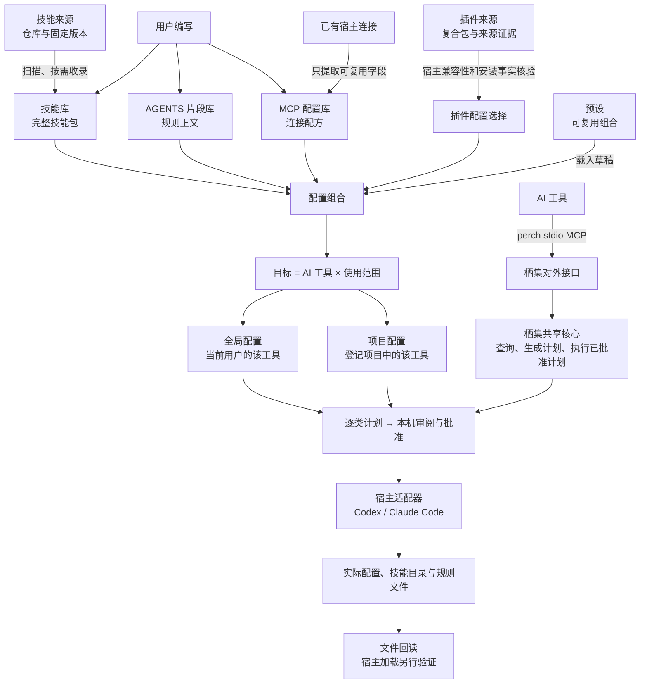

# 从用户任务重整配置体验

日期：2026-10-23。本文保留改版前的源码审阅，并记录本轮实现边界与 BDD 验收契约。四组导航、配置关系图、MCP 使用入口与状态、接入任务顺序、项目宿主独立选择已写入代码；本轮新增的 3 个核心 BDD 与 3 个原生 BDD 场景均已通过，完整回归零失败、零跳过。点击数来自明确起点下的控件路径推导，尚未完成真实用户计时或原生窗口点击测量，不能作为已测改善数据。

栖集的主任务是：**把选定能力用于指定项目或全局范围中的某个 AI 工具，并看清将改变什么。** 页面首先回答使用对象、使用范围、选择内容和当前状态；来源、配置格式与完整指纹按需展开。改版不能只换导航名称：项目中的不同 AI 工具需要能保存不同组合，资源库到配置的入口需要携带已选资源，配置写入与宿主加载需要保持不同状态。

## 1. 当前问题与证据

阅读范围包含 [原生架构](architecture.md)、[MCP 契约](mcp.md)、[全局配置](global-configuration.md)、[BDD 约定](bdd.md)、[DESIGN.md](../../DESIGN.md) 和对应 SwiftUI / Core 实现。检查时仓库不存在 `GLOSSARY.md` 或 `docs/adr/`，沿用现有文档中的领域名称，不新增另一套术语。

| Before | After | Why |
| --- | --- | --- |
| 侧栏把 MCP 服务、插件来源、AI 接入放进同一个“AI 工具”分组 | 按“配置 / 能力库 / 来源 / 对外接口”分组，页面名称保留用户已有习惯 | 资源、来源和接口承担不同任务；同级排列会让用户误认为都是安装入口 |
| 项目选择 Codex / Claude Code 后，共用一组技能与片段 | 每个 AI 工具拥有独立组合；切换工具只切换编辑对象，明确的启用/移除操作才改变部署目标 | 多选宿主已经可用，缺失的是每个宿主不同的内容。只加分段控件无法解决数据共享 |
| MCP 配置库详情只显示命令和原始参数，使用要跳页后重新找到服务 | 详情回答“连接什么、保存在哪里、在哪些范围选用”；从当前条目直接选择目标并预览 | 用户不应记住名称，再去另一长列表搜索同一服务 |
| 配置库、已有连接和 AI 接入都以 MCP 为主题，但方向依赖长文解释 | 配置库说明“给 AI 工具添加外部能力”；对外接口说明“让 AI 工具调用栖集” | 相同协议不代表相同对象，必须显示调用方向 |
| 扫描候选混合名称、长路径、参数和禁用原因 | 先显示名称、来源 AI 工具与范围、能否入库；长参数与原始路径按需核对，阻塞原因常驻 | 用户先决定能不能选，再核对细节；不能把错误一起折叠 |
| AI 接入先显示程序路径和构建来源，再显示接入操作 | 接入对象、目标配置与主操作置顶，程序诊断折叠 | 降低滚动与阅读成本；此调整不减少必要审批次数 |
| 项目页“预览变更”容易被理解为所有组件都会一起部署 | 技能与规则、MCP、插件分别标明此次计划的内容与影响范围 | 三者的执行器与风险边界不同，视觉统一不代表可合并批准 |

证据定位：导航分组在 `NavigationItem.groups`；项目共享选择在 `ProjectDraft.skillIDs / instructionIDs / agents`、`ProjectsView.hostPicker` 与 `AppModel.prepareDeploymentPlan`；MCP 跳转与扫描在 `MCPServersView`、`MCPLibraryScanSheet`；按宿主和范围保存 MCP 选择在 `MCPLibraryModel`；接入顺序在 `AIAccessView`；两次批准在 `PlanSheet`。

本仓实现的宿主名称是 Codex 与 Claude Code。用户提到的 Harness 在本文对应“AI 工具 / 宿主”；不把它与 AGENTS 片段、插件贡献的 agents 或栖集自身 MCP 接口混为同一层。

## 2. 层级与真实关系



图中的“配置组合”描述用户正在选什么，不引入新的数据库实体。现有项目预设可包含技能、片段、结构化 MCP 草稿与插件引用；MCP 配置库的 UUID 选择目前独立保存，不能把两条路径描绘成已经统一。

| 层级 / 对象 | 回答的问题 | 与其他模块的关系 | 不应暗示的含义 |
| --- | --- | --- | --- |
| 技能来源 | 内容从哪里来、固定在哪个版本？ | 发现候选后，显式收录为本机完整技能包；来源证据跟随条目 | 来源存在不代表已加入项目；来源删除不删除已导入技能 |
| 插件来源 | 插件包从哪里来、包含什么？ | 插件可能贡献技能、MCP、命令、agents、hooks；安装使用宿主生命周期计划 | 插件不是“另一种技能”；缓存、收录、安装与启用不是同一状态 |
| 技能库 | 有哪些可选的完整技能包？ | 被项目、全局或预设引用；部署使用固定内容版本 | 库中有条目不代表任何宿主已加载 |
| AGENTS 片段 | 要写入哪些行为规则？ | 合成后写入所选宿主对应的 AGENTS.md / CLAUDE.md 标记区 | 片段不是可运行 Agent，也不是独立宿主 |
| MCP 配置库 | 有哪些可以复用的服务连接？ | 不绑定宿主和范围；使用时由适配器转为宿主配置 | 入库不启动服务，编辑库不自动更新既有连接 |
| 预设 | 怎样复用一套选择？ | 将组合载入项目草稿；之后仍分别生成技能/规则、MCP、插件计划 | 预设不拥有宿主，不是使用范围，也不等于安装结果 |
| 全局配置 | 当前用户使用此 AI 工具时共用什么？ | 按宿主保存草稿与管理记录；项目可能继承这些内容 | 不把 HOME 当成项目；项目取消选择不代表关闭全局继承 |
| 项目配置 | 此项目中的此 AI 工具使用什么？ | 项目 realpath 确定范围，宿主确定目标路径和格式 | 相同项目中的两个宿主不应被迫共用技能/规则组合 |
| AI 工具 / 宿主 | 谁读取并使用配置？ | Codex 与 Claude Code 是消费者，适配器负责路径与格式差异 | UI 支持某按钮不证明宿主版本兼容或会话已加载 |
| 栖集对外接口 | AI 如何查询栖集、准备计划？ | `perch` stdio MCP 调用共享核心；与 App、CLI 共用审批及执行规则 | 不提供批准工具，不是对外 HTTP 服务，也不是第三方 MCP 配置库 |

全局、项目和预设是三个不同维度。全局与项目是作用范围；预设是复用组合的方式。将预设展示在“配置”分组是为了缩短常用路径，不意味着它是第三种作用范围。

### 两条 MCP 调用方向

```text
AI 工具 ──读取已写入的连接配置──→ 外部 MCP 服务
          ↑
      栖集 MCP 配置库提供可复用连接配方

AI 工具 ──调用 perch 的工具──→ 栖集共享核心
          ↑
      栖集“AI 接入”帮助配置自身 stdio 接口
```

前者管理别人提供的能力，后者暴露栖集自己的能力。它们可以写进同一个宿主配置文件，但用户任务、所有权和状态必须分开。提供 `streamable-http` 连接字段不等于栖集自身开启 HTTP 监听。

## 3. 信息架构与页面任务

| 侧栏分组 | 页面 | 用户任务 |
| --- | --- | --- |
| 配置 | 全局配置、项目、预设 | 决定给谁、在哪个范围、使用哪套组合 |
| 能力库 | 技能库、AGENTS 片段、MCP 服务 | 阅读、维护和选用可以复用的内容 |
| 来源 | 技能来源、插件来源 | 发现与收录内容，核对版本和来源证据 |
| 对外接口 | AI 接入 | 让 AI 经栖集 MCP 查询内容、准备计划 |

在侧栏底部提供按需打开的“配置关系图”。图中节点可进入对应页面，用户不用读完说明再返回侧栏找入口。关系图解释层级，不成为每次配置之前必须经过的新步骤；正常任务依然从项目或全局配置开始。

### 配置页：先确定目标，再编辑内容

页面上方常驻显示项目或全局范围、当前 AI 工具和草稿状态；目标路径可复制。切换宿主保持草稿、搜索上下文和计划边界清楚，不能把“切换编辑对象”做成“取消另一宿主部署”。

技能与规则显示当前宿主的选择。MCP 与插件保留各自计划入口，并在按钮旁说明影响范围。Codex 项目级 MCP 使用 `.codex/config.toml`，在项目选择、预览与接入向导中说明可信项目才会加载，栖集不修改信任设置。Codex 插件仍未适配项目范围，显示原因及前往全局的入口，禁止静默改成用户作用域。

若同一宿主下存在多个待执行变化，预览前说明该计划包含整组草稿的变化；不能把“从一个资源点击使用”暗示为计划只会改变这一项。项目技能/规则预览只提交当前宿主，另一宿主的未部署草稿保留；MCP 预览则处理已选宿主与范围的整组 MCP 草稿。

### MCP 页：配方与实际连接并排解释

提供“配置库 / AI 工具中的配置”两个视图：配置库展示可复用配方，后者展示磁盘中的连接观察。配置库主操作是新增或扫描入库，条目详情主操作是“用于配置…”。编辑、删除与诊断降低视觉权重。

“用于配置”的默认目标取进入配置库时的真实页面：项目页保留当前项目和工具，全局页保留该工具的全局范围；从其他页面直接进入则使用当前全局工具。遗留的项目选择不能覆盖全局入口。Codex 项目 MCP 目标为项目目录下的 `.codex/config.toml`，范围选择器显示项目必须受信任；仍由用户确认后才生成计划，不会改选 Claude Code。目标已经失效时要求重新选择，不自动扩大范围。

详情先展示名称、连接方式、命令或服务地址、使用状态；完整参数、原始路径与变量名保持可核对。当前依据草稿选择与已部署记录显示“草稿已选择 / 有写入记录”；历史记录不代表当前文件仍一致或宿主正在运行。库配置与写入快照的更新差异需要生成新计划核对，当前详情没有“配置有更新”徽章。扫描到同名外部连接不足以断言该连接由库条目部署。

扫描表单保留逐项选择。若提供批量选择，只选择可入库且无同名冲突的候选；不增加默认为全选的入库或启用行为。入库完成说明数量及后续使用入口，不显示“服务已启用”。

### AI 接入：先完成接入，再按需诊断

选择 Codex / Claude Code、状态、真实配置路径和“生成接入计划”在程序细节之前。程序位置、启动参数、协议与工具说明放入可展开区域；缺失程序、外部同名冲突、配置不可读等阻塞原因始终可见。

常驻一句话交代方向：“让 AI 工具查询栖集并准备配置计划。”成功状态采用“配置已写入，需在 AI 工具中确认加载”；工具数量以实际发现结果为准，不用静态数字替代连接验证。

## 4. 两项衡量标准

### 点击数

计数包括按钮、列表项、复选框、分段选项及确认动作；菜单打开和菜单项选择分别计一次。不计算文本输入、文本选中、阅读、滚动或系统目录选择器内部路径操作；这些成本另行记录，不能因未计点击就忽略。下表基于正常成功路径，所有资源可用、没有冲突、默认目标符合意图；如果需要换宿主或范围，必须追加实际选择次数。

| 任务与明确起点 | 改版前源码路径 | 改版前点击 | 目标路径与预算 | 状态 |
| --- | --- | --- | --- | --- |
| 已在 MCP 配置库、目标条目详情可见；从全局配置进入且目标工具已选定，将它用于同一全局范围 | 前往全局配置 → 重新找到并勾选 → 预览 MCP 变更 → 批准 → 二次确认 | 5 | 用于配置 → 加入草稿并预览 → 批准 → 二次确认，共 4 | 目标预算，需按实际交互复测；若从项目进入而需改为全局，打开菜单并选择另加 2 次 |
| 已在 MCP 配置库，将一个可用扫描候选入库，以出现成功结果为终点 | 扫描已有配置 → 勾选候选 → 将所选服务入库 | 3 | 到成功回执仍为 3；点击“在配置库查看”返回列表为第 4 次 | 保留逐项选择和明确回执，不把返回列表隐去不计 |
| 默认项目页，将栖集接入默认 Codex，程序完整且尚未配置 | AI 接入 → 生成接入计划 → 批准 → 二次确认 | 4 | 保持 4；主操作前置、减少程序说明造成的滚动 | 审批不削减；不把布局优化写成点击下降 |
| 已选项目，准备给 Claude 配置一套不同于 Codex 的技能/规则 | 共享组合会同时用于所选宿主 | 无可完成路径 | 切换 Claude → 选择一项 → 预览 → 批准 → 二次确认，5；已在 Claude 时 4 | 需要端到端的宿主独立数据与计划支持 |
| 任意主页面，理解模块关系后前往一个模块 | 依赖阅读分散说明与自行回侧栏查找 | 无统一路径，不估造总数 | 配置关系图 → 目标节点，2 | 不增加日常配置步骤 |

点击下降不是唯一目标。一次审批、明确选择目标、保留取消入口都是有价值的动作；要去掉的是重复找资源、重复选择已知目标和跨页丢失上下文。另记录每条路径的跨页次数、需要重新寻找资源的次数、主操作进入视口前的滚动次数和取消后丢失输入的次数。

### 数据清晰度

验收让用户面对同一份固定示例回答以下问题，记录正确率及回答用时；目前没有用户测试数据，不设置虚构改善百分比。

| 问题 | 默认可见的证据 | 不合格表现 |
| --- | --- | --- |
| 我正在改谁的配置？ | 当前 AI 工具及全局 / 项目名称 | 需要根据路径猜宿主，或切换页面后丢失目标 |
| 影响一个项目还是所有项目？ | 范围文字与真实路径；全局影响就近说明 | 只显示“用户”却不解释影响全部项目 |
| 这项只是收录、只是草稿，还是已经写入？ | 以对象为单位的状态与当前计划入口 | 一枚绿色徽章同时代表收录、安装和加载 |
| 这项来自哪里，修改会影响什么？ | 来源名称、版本摘要、库编辑与已写入连接的关系 | 编辑库后直接显示所有项目已更新 |
| 下一步是什么，为什么不能操作？ | 一个清晰主操作；禁用原因在旁边 | 只禁用按钮、隐藏错误，或依赖全局 toast |

列表优先支持比较：名称、连接方式、宿主、范围、状态采用固定顺序；不将长 hash、命令、风险说明都挤进列表。完整内容放在详情，失败与冲突不折叠。用户需核对的原始路径、协议字段和第三方名称保留原文。

## 5. 宿主独立配置的实施约束

本轮已将以下契约贯穿草稿、manifest、部署器和原生入口，验证结果单独记录；不能仅凭视觉切换就标为通过。

1. 项目草稿按宿主保存技能与片段选择；全局配置已经采用宿主独立草稿，MCP 配置库选择也已经按宿主和范围独立保存。
2. 兼容旧的共享 `skillIDs / instructionIDs / agents`：为原有已选宿主生成相同初值，不增加原来未选的宿主，不自动生成计划或写项目。保留旧读取与恢复路径的兼容性证据。
3. 编辑某一宿主时，不将其他宿主缺席误解为“取消使用”；生成计划必须保留其他宿主的已部署技能、规则及归属记录。主动停止该宿主管理是另一项明确动作。
4. 预设载入、片段“用于配置”、MCP / CLI 生成计划都要说明目标宿主。单宿主覆盖与多宿主共同应用分别可见，不能由 UI 默认值悄悄扩展范围。
5. 计划摘要、部署快照和对象引用足以表达不同宿主的不同组合；不通过临时合并草稿伪造独立。回滚保留未参与本次操作的另一宿主内容，失败后仍能判断哪项完成。
6. 技能同名冲突以实际宿主目标目录为边界；两宿主各选不同来源但同名的技能，不应因共用顶层列表被错误阻塞。

实际字段为可选 `harnessSelections: [String: ProjectHarnessSelection]`，按宿主保存技能 ID 与片段 ID，顶层保留并集以兼容旧读取者；旧格式通过 `resolvedHarnessSelections` 展开。`makeHarnessPlan` 使用当前宿主草稿与其他宿主已部署选择生成计划，不带入其他宿主的未部署草稿。

**本轮边界：独立选择已实现，每宿主固定不同 revision 尚未实现。** 当库版本、片段正文或安装方式变化导致另一个宿主文件也会改变时，单宿主计划在保存前返回 `HARNESS_SCOPE_CONFLICT` 并清理 staging，提示核对相应工具。两个宿主共用同一技能或片段时，切换到另一个工具仍可能遇到相同冲突，共用内容更新可能需要通过 CLI / MCP 显式生成多宿主计划；原生单宿主入口不会自动合并更新。当前也不能让同一技能 ID 在两宿主保留不同版本。MCP / CLI 的单宿主追加与已有独立配置的单宿主更新同样检查实际路径，明确选择多个宿主仍生成共同计划，完整契约见 [原生架构](architecture.md)。

此变更位于现有 S2（不同项目的能力选择）、S4（预设复用）、S5（审批）和 S6（宿主配置）之内。它不同时引入更多宿主、marketplace 安装、HTTP 服务、跨进程锁或自动重载。

## 6. BDD 验收契约

以下为完整行为验收契约，部分已映射到本轮新增的 3 个核心及 3 个原生场景。只有对应步骤注册、真实执行且可观察断言通过后，才能进入“已验证”清单。验证使用隔离 HOME、项目与本机数据目录：服务层验证文件和失败边界，原生 UI 验证用户能到达并完成路径；Accessibility 不可用时明确跳过。执行规则见 [BDD 约定](bdd.md)。

| 层级 | 已接入场景 | 可观察结果 | 本轮状态 |
| --- | --- | --- | --- |
| 核心服务 | 两个 AI 工具只收到各自选择的技能 | 审批前零目标写入；批准后各自路径存在，交叉路径不存在 | 已通过 |
| 核心服务 | 清空 Claude 的选择后 Codex 内容保持不变 | 批准后移除 Claude 技能，Codex 文件字节不变 | 已通过 |
| 核心服务 | 预览 Claude 不会连带部署 Codex 的草稿 | 单独提交 Claude 不产生 Codex 文件，随后可以单独提交 Codex | 已通过 |
| 原生窗口 | 从配置关系图进入能力库不会修改项目 | 点击关系图节点实际到达 MCP 配置库，零计划且项目不变 | 已通过 |
| 原生窗口 | 对外接口说明调用方向且查看不会生成计划 | 显示“AI 工具 → 栖集”及全局范围，零计划 | 已通过 |
| 原生窗口 | MCP 入库后可直接选择使用范围并取消写入 | 手动保存条目后直达目标选择与 MCP 计划；批准前及取消后都不写 Codex 配置 | 已通过 |

新增 MCP 原生场景通过手动表单入库，不覆盖扫描导入回执，也没有执行批准写入；不能将该场景作为扫描路径或完整四次写入路径的实测证据。

```gherkin
# language: zh-CN
功能: 清楚地选择能力和配置目标

  场景: 用户只想把一个已有 MCP 连接收录到库
    假设隔离宿主中有一个可安全提取的 MCP 连接
    当用户扫描并选择该连接入库
    那么配置库包含它的连接配方和环境变量名称
    并且宿主原始配置字节保持不变
    并且没有新增目标选择或写入计划

  场景: 用户从 MCP 条目详情直接使用已有配方
    假设配置库中有一个条目且目标配置草稿包含另一项选择
    当用户从该条目选择目标并加入草稿以预览
    那么目标草稿保留原选择并加入当前条目
    并且计划说明整组草稿的新增更新和移除
    并且在批准之前目标配置文件保持不变

  场景: 用户取消目标选择
    假设用户从 MCP 条目打开用于配置窗口
    当用户在加入草稿之前取消
    那么所有目标的草稿字节保持不变
    并且没有新增计划和目标文件写入

  场景: 用户取消 MCP 计划审批
    假设当前条目已加入所选目标的草稿并生成计划
    当用户取消审阅或取消第二次确认
    那么草稿仍保留选择
    并且计划仍未批准且目标文件保持不变

  场景: 用户切换项目中的 AI 工具以编辑不同组合
    假设同一项目的 Codex 与 Claude Code 分别选择不同技能和规则
    当用户切到 Claude Code 并修改一个选择后再切回 Codex
    那么 Codex 原选择保持不变
    并且再次打开项目时两个工具仍保留各自选择

  场景: 用户只部署一个 AI 工具的变化
    假设项目中两个 AI 工具都有已部署内容和本机归属记录
    当用户只批准 Claude Code 的新选择
    那么 Claude Code 的目标文件体现新选择
    并且 Codex 的技能规则文件及其归属记录保持不变

  场景: 旧共享草稿迁移后不改变项目
    假设旧草稿为 Codex 与 Claude Code 共同选择技能和片段
    当新版读取并展示该项目
    那么两个工具都显示原来的选择
    并且项目文件保持不变且没有自动生成计划

  场景: 用户尝试将 MCP 配置用于尚未支持的范围
    假设用户选择 Codex 的项目范围
    当用户查看 MCP 配置入口
    那么界面说明该范围尚未适配并提供前往全局的入口
    并且不会自动改选全局或生成用户级写入计划

  场景: 外部同名服务阻止覆盖
    假设目标配置存在未经栖集管理的同名 MCP 服务
    当用户预览配置库条目的使用计划
    那么界面显示同名冲突及目标范围
    并且外部服务与其他配置保持不变

  场景: 修改配置库后已写入连接保持原样
    假设一个配置库条目已在某个目标写入
    当用户编辑该条目的连接信息
    那么配置库显示新信息
    并且已部署快照和目标文件保持原样直到新计划被批准

  场景: 用户区分栖集接口与外部能力
    假设用户打开配置关系图
    当用户选择栖集对外接口节点
    那么进入 AI 接入并看到从 AI 工具调用栖集的说明
    并且切到 MCP 配置库时看到给 AI 工具添加外部服务的说明
    并且单纯浏览不生成计划或修改宿主配置

  场景: 接入配置写入不能被误报为服务已经加载
    假设栖集接入计划在隔离宿主配置中写入成功
    当用户返回接入页面
    那么界面说明已找到配置并需由 AI 工具确认加载
    并且不把配置存在展示成连接成功或工具已可用
```

失败场景另覆盖读取失败、扫描后候选发生变化、保存失败保留输入、库条目删除后的失效引用、另一宿主发生本地修改以及计划过期。验证断言来自固定的预期内容、原始文件字节、审批记录和实际目标路径，不重复调用被测映射函数来生成“期望值”。

## 7. 实施顺序与验证记录

先完成导航与关系图、MCP 调用方向、接入主操作前置和资源详情直接使用，解决任务入口与信息层级。并行完成项目宿主独立选择的数据契约与行为验证，再连接项目编辑、预设、规则快捷使用、计划和回滚路径。宿主隔离未贯通时，不能把“只改了当前面板”当成“只写当前宿主”。

建议验证按三层记录：

- **服务行为**：临时文件中证明审批前零目标写入、保存与切换隔离、批准后仅目标宿主改变、旧数据兼容、冲突与过期拒绝。
- **原生窗口行为**：实际点击 MCP 直达路径、宿主切换、关系图节点、取消和双层确认，回读隔离文件；分别记录实际点击数与额外导航。
- **视觉和理解**：1080 × 700 与默认窗口、浅色与深色、长路径和长名称、空库及错误态；确认主操作可见、状态不只靠颜色、键盘切换无动画。

2026-10-23 本机验证结果：

| 验证 | 结果 |
| --- | --- |
| `CUCUMBER_TAGS=bdd CUCUMBER_VERBOSE=1 swift test` | 31 个 Gherkin 场景、399 个步骤全部通过；BDD target 共 406 项（包含另外 7 项原生流程测试）；核心 XCTest 11 项、Swift Testing 140 项、应用 XCTest 93 项全部通过，零跳过 |
| `swift test --filter ConfigurationExperienceLayoutTests` | 最后调整后的专项验证通过；1080 × 700 主页面及 760 × 640 关系图在明暗外观下未撑大窗口，滚动内容可到达底部 |
| 本地化、目录指纹、diff 检查 | 4 项本地化测试、`scripts/catalog.py verify`、`git diff --check` 均通过 |
| `./script/build_and_run.sh --no-open` | 生成 `dist/栖集.app`；签名校验通过，App 内 helper 与独立 CLI 在仓库外均完成 MCP 握手和 17 个工具的发现 |
| 真实窗口目视核对 | 使用隔离数据及独立应用标识启动打包程序；MCP 主操作、可滚动关系图与直达 AI 接入均可见，未生成计划或宿主配置 |

原生中文截图保存在 `artifacts/configuration-experience/{mcp,map,access}-native.png`，该目录为本机验证产物。NSHostingView 缓存截图不作为真实标题栏可见性的唯一证据，原生窗口已另行目视核对。没有实测用户理解率、真实 AI 工具中的加载与接入连通性，或点击耗时，不以代码实现或测试夹具代替这些证据；不修改真实宿主配置、用户技能库或项目文件来演示流程。

发布前复审补充（2026-10-23）：独立两轴 review 后修正了片段引用的宿主定位、过期计划提示、MCP 诊断映射及入口目标、URL 参数凭据检测和 skills.sh 来源身份判定。完整 Swift 回归通过：BDD 31 场景 / 399 步骤（target 共 406 项）、核心 XCTest 11 项、Swift Testing 140 项、应用 XCTest 100 项。最后的 MCP 与目录边界修改另跑相关专项，应用 XCTest 45 项、Swift Testing 35 项全部通过。Python 全量 31 项与 Node 5 项通过；Python 夹具显式创建本机片段，避免依赖产品默认数据。全部成功运行均零失败、零跳过。审查与发包记录见[build 6 发布记录](../releases/perch-0.0.1-6.md)。
